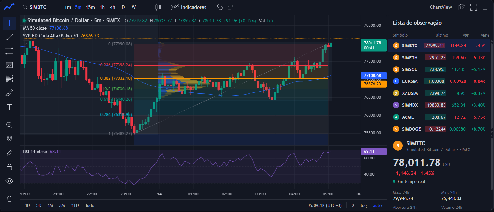
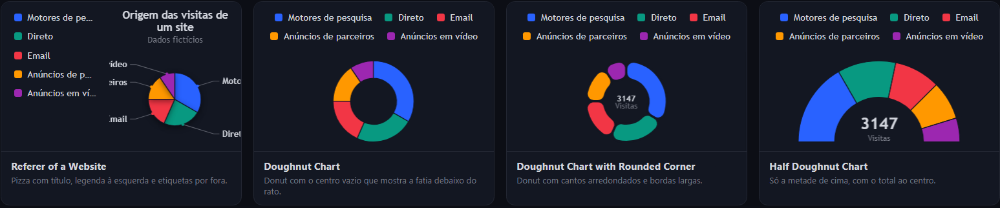
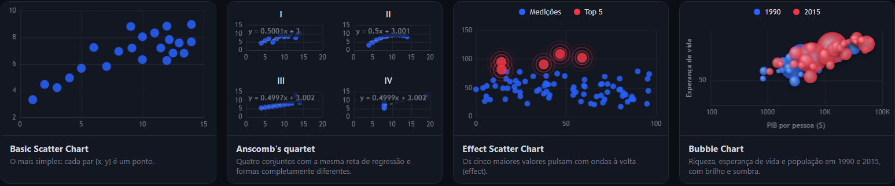
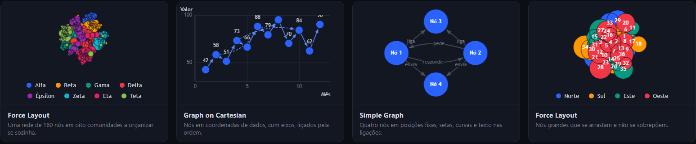
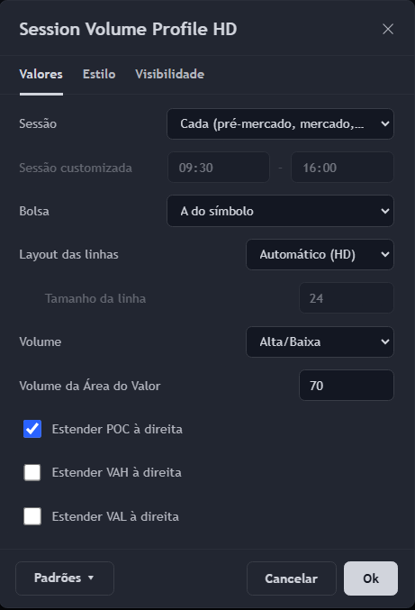
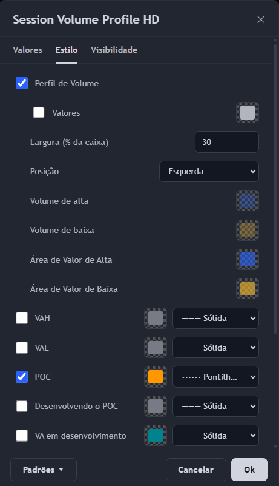
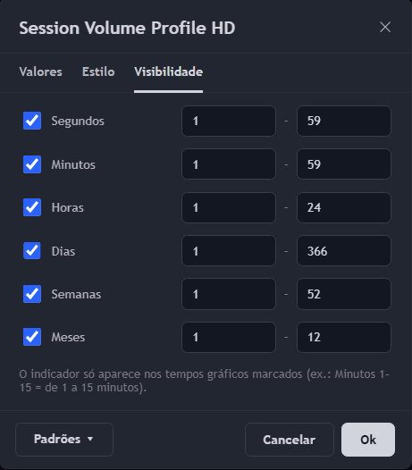

# OpenChartsCandle

**Financial and data charts for the web, in TypeScript and Canvas 2D, with zero runtime dependencies.**

A full TradingView-style candlestick terminal (drawing tools, indicators, trades, sessions, time zones) plus 17 more chart families in the spirit of ECharts: pie, line, bar, gauge, treemap, scatter, heatmap, graph, sankey and more.

[](https://github.com/TTiagoSousa/OpenChartsCandle/actions/workflows/ci.yml)
[](https://github.com/TTiagoSousa/OpenChartsCandle/releases)
[](LICENSE)
[](https://ttiagosousa.github.io/OpenChartsCandle/)

[Live demo and gallery](https://ttiagosousa.github.io/OpenChartsCandle/) · [Documentation](#documentation) · [Changelog](CHANGELOG.md) · [Português](README.pt-PT.md)



## Why

- **No dependencies at runtime.** Every chart is drawn on a canvas by the library itself. Import only the family you use.
- **TradingView-like where it matters.** Same indicator values as TradingView, the same settings dialog (Inputs / Style / Visibility), kinetic scrolling, pixel-crisp candles, history loaded in chunks.
- **Built for trading apps.** Plug in your own data feed, show the trades of a backtest with live P&L, draw the sessions of any exchange, switch time zones.
- **Typed.** Written in strict TypeScript, with declarations for every entry point.

## Chart families

Each family has its own entry point, docs and examples. The [gallery](https://ttiagosousa.github.io/OpenChartsCandle/#/galeria) has 279 ready-to-copy charts.

| Family | Import | What it draws |
|---|---|---|
| **Candlestick** | `openchartscandle/candlestick` | TradingView-style terminal or bare chart: candles, bars, Heikin Ashi, line, area, baseline |
| **Pie** | `openchartscandle/pie` | Pie, donut, half donut, Nightingale rose |
| **Line** | `openchartscandle/line` | Lines and areas, stacked, smooth or stepped, real time |
| **Bar** | `openchartscandle/bar` | Columns and bars, grouped, stacked, 100%, moving averages, trends, Pareto |
| **Gauge** | `openchartscandle/gauge` | Speedometers, progress rings, zones and markers |
| **Treemap** | `openchartscandle/treemap` | Squarified treemap and sunburst, drill-down |
| **Scatter** | `openchartscandle/scatter` | Scatter and bubbles, regressions, clustering, scatter matrix |
| **Calendar** | `openchartscandle/calendar` | Days as a heatmap (GitHub style) or a wall calendar |
| **Radar** | `openchartscandle/radar` | Radar / spider charts |
| **Boxplot** | `openchartscandle/boxplot` | Box-and-whisker plots from raw samples or ready boxes |
| **Heatmap** | `openchartscandle/heatmap` | Heatmaps, correlation matrices, 20 000+ cells |
| **Graph** | `openchartscandle/graph` | Networks with force (Barnes–Hut), circular or fixed layouts |
| **Tree** | `openchartscandle/tree` | Tidy trees in four orientations and radial |
| **Parallel** | `openchartscandle/parallel` | Parallel coordinates with brushing and draggable axes |
| **Sankey** | `openchartscandle/sankey` | Flow diagrams |
| **Funnel** | `openchartscandle/funnel` | Funnels and pyramids with conversion rates |
| **Matrix** | `openchartscandle/matrix` | Grids with multi-level headers and charts inside the cells |
| **Custom** | `openchartscandle/custom` | Your own series with `renderItem`, animated transitions, hexbin, circle packing |





## The candlestick terminal

`createTerminal` builds the whole interface. `createChart` gives you only the canvas, to build your own around it.

### What you get

| Area | Features |
|---|---|
| **Chart types** | Candles, bars (OHLC), hollow candles, Heikin Ashi, line, step line, area, baseline |
| **Timeframes** | 1m, 3m, 5m, 15m, 30m, 1h, 2h, 4h, 1D, 1W, or custom ones (`'45'`, `'2h'`, `'3D'`); type `15` + Enter on the chart to switch |
| **Price scale** | Auto, logarithmic, percentage and inverted; last price line with a countdown to the bar close |
| **Navigation** | Kinetic scroll, wheel zoom, range buttons (1D, 5D, 1M, 3M, YTD, All), go to a date or to a trade |
| **Data** | `Datafeed` interface with history in chunks (like TradingView), real-time updates, resync after a reconnect |
| **Time zones** | Browser time, UTC, the exchange's zone or any IANA zone, from the clock menu or by code |
| **Interface** | Symbol search, watchlist with symbol details, legend, undo / redo, screenshot, full screen, keyboard shortcuts |
| **Appearance** | Dark and light themes, every colour configurable, chart-only mode, compact mode for cards, borders and rounded corners |
| **Trades** | Entries and exits of a strategy with live P&L, entries only / exits only / both, a linked trade list, go to a trade by id, statistics |
| **Annotations** | Markers, time ranges (shaded zones and vertical lines) |

Every piece of the interface can be turned off or limited to a list:

```ts
createTerminal(el, {
  datafeed,
  watchlist: false,
  timeframeSelector: ['5', '15', '60', '240', '1D'],
  chartTypes: ['candles', 'heikin', 'line'],
  indicatorPicker: ['sma', 'rsi'],
  drawingTools: ['trendline', 'hline', 'fib', 'long', 'short', 'rect'],
  screenshot: false,
});
```

### Drawing tools

26 tools, with a magnet (snap to OHLC), Shift for 45° angles, undo / redo, copy / paste, lock, hide, clone and a settings dialog per drawing. Drawings can also be created by code and saved anywhere.

| Group | Tools |
|---|---|
| **Lines** | Trend line, ray, info line (Δ price, %, bars, angle), extended line, arrow, horizontal line, horizontal ray, vertical line, cross line, parallel channel |
| **Fibonacci** | Retracement, trend-based extension, Fibonacci channel |
| **Forecasting** | Long position, short position, price range, date range, date and price range |
| **Volume** | Fixed range volume profile, anchored VWAP |
| **Shapes** | Brush, rectangle, ellipse, triangle, path |
| **Annotation** | Text |

### Indicators

Indicators match TradingView's values and are computed incrementally in real time. Any of them can run on another timeframe than the chart (a 4h moving average on a 5m chart).

| Indicator | `type` | Settings |
|---|---|---|
| **Moving Average** | `sma` | Length, source (open, high, low, close, volume), offset, timeframe, colour, width |
| **Moving Average Exponential** | `ema` | Same as the SMA |
| **Relative Strength Index** | `rsi` | Length, source, timeframe; smoothing with an SMA or an EMA; upper, middle and lower bands with level and colour; background between the bands |
| **Session Volume Profile HD** | `svp` | See below |

**Session Volume Profile HD** splits the chart into the sessions of the trading day and draws a volume profile for each one, like TradingView's:

- **Sessions:** each part on its own (pre-market, market, post-market, overnight), all together, only one part, or custom hours (`'0930-1600'`, several ranges, across midnight).
- **Exchanges:** the symbol's own hours, or NYSE / Nasdaq, CME, B3, Euronext, Xetra, LSE, TSE, HKEX, Forex and crypto, each in its own time zone.
- **Rows:** automatic HD rows that follow the zoom, a fixed number of rows, or ticks per row.
- **Volume:** up / down, total or delta; value area percentage (70% by default).
- **Levels:** POC, VAH and VAL, each with colour and line style, extended to the right until a later bar touches them; developing POC and developing value area.
- **Style:** histogram width and side, up / down and value area colours, a background box per session, values on the rows, labels on the price scale.

### Settings dialog

Every indicator opens the same dialog as TradingView, with **Inputs**, **Style** and **Visibility** tabs, a "Defaults" menu to reset it, and Cancel to undo every change. The Visibility tab chooses on which timeframes the indicator is shown (seconds, minutes, hours, days, weeks and months, each with a range).

| Inputs | Style | Visibility |
|---|---|---|
|  |  |  |

### Keyboard shortcuts

| Keys | Action |
|---|---|
| `Alt + T` / `H` / `J` / `V` / `C` / `F` | Trend line, horizontal line, horizontal ray, vertical line, cross line, Fibonacci |
| `Del` / `Backspace` | Delete the selected drawing |
| `Esc` | Cancel the current drawing, leave the tool, deselect |
| `Ctrl + Z` / `Ctrl + Y` | Undo / redo |
| `Ctrl + C` / `Ctrl + V` | Copy / paste the selected drawing |
| `Alt + R` | Reset the chart view |
| `←` `→` / `↑` `↓` | Scroll / zoom |
| `15` + `Enter`, `4h`, `D`, `W` | Change the timeframe by typing |

## Installation

Install a tagged version straight from GitHub. The build (`dist/`) is included in every tag, so nothing is compiled on install.

```bash
npm install github:TTiagoSousa/OpenChartsCandle#v1.0.0
```

To update, change the tag and run `npm install` again.

## Quick start

### Full terminal

```ts
import { createTerminal, type Datafeed } from 'openchartscandle/candlestick';
import 'openchartscandle/style.css';

const datafeed: Datafeed = {
  getSymbols: () => [{ symbol: 'BTCUSDT', precision: 2 }],
  // history in chunks: `to` is exclusive, `countBack` bars, `signal` to cancel
  getBars: async (symbol, tf, { to, countBack, signal }) => {
    const bars = await api.candles(symbol, tf.id, to, countBack, signal);
    return { bars, noMore: bars.length < countBack };
  },
  // real time: call onBar with each new or updated bar, return an unsubscribe function
  subscribeBars: (symbol, tf, onBar) => socket.subscribe(symbol, tf.id, onBar),
};

createTerminal(document.getElementById('chart')!, { datafeed, symbol: 'BTCUSDT', timeframe: '5' });
```

The container needs a height, for example `#chart { height: 600px }`.

### Chart only

```ts
import { createChart, createIndicator } from 'openchartscandle/candlestick';
import 'openchartscandle/style.css';

const chart = createChart(document.getElementById('chart')!, { symbol: { symbol: 'EURUSD', precision: 5 } });

chart.setData(bars, 3600);   // history; 3600 = one-hour bars
chart.update(lastBar);       // real time: the same time replaces, a new time appends
chart.addIndicator(createIndicator('rsi', { maType: 'ema', maLength: 9 })!);
chart.addIndicator(createIndicator('svp', { session: 'regular', exchange: 'NYSE' })!);
chart.setTimezone('Europe/Lisbon');
chart.drawings.setTool('fib');
```

A bar is `{ time, open, high, low, close, volume }`, with `time` as the bar's start in UTC seconds (milliseconds are converted). Bars are sorted and de-duplicated, and gaps (weekends, closed markets) leave no empty space.

### Other families

```ts
import { createPieChart } from 'openchartscandle/pie';
import { createHeatmapChart, heatmapCorrelation } from 'openchartscandle/heatmap';

createPieChart(el, {
  data: [{ label: 'Stocks', value: 60 }, { label: 'Bonds', value: 25 }, { label: 'Cash', value: 15 }],
  innerRadius: 0.6, // donut
});

createHeatmapChart(el2, {
  xAxis: { data: assets },
  yAxis: { data: assets, inverse: true },
  matrix: heatmapCorrelation(returns), // one array of returns per asset
  visualMap: { min: -1, max: 1, colors: ['#f23645', '#f7f7f7', '#089981'] },
});
```

## Documentation

The full reference is in [`docs/`](docs) (in Portuguese) and on the [demo site](https://ttiagosousa.github.io/OpenChartsCandle/), where every example runs live next to its source code.

| Topic | Document |
|---|---|
| Candlestick API (`createTerminal`, `createChart`, `Chart`, events, theme, indicators) | [docs/candlestick/api.md](docs/candlestick/api.md) |
| Connecting data (`Datafeed`, Binance and database examples) | [docs/candlestick/datafeed.md](docs/candlestick/datafeed.md) |
| Appearance (themes, chart-only, compact, time zones) | [docs/candlestick/aparencia.md](docs/candlestick/aparencia.md) |
| Drawing tools (ids, shortcuts, drawings by code, saving) | [docs/candlestick/desenhos.md](docs/candlestick/desenhos.md) |
| Trades, markers, statistics and simulation indicators | [docs/candlestick/entradas-saidas.md](docs/candlestick/entradas-saidas.md) |
| Other families | `docs/<family>/api.md`, for example [docs/heatmap/api.md](docs/heatmap/api.md) |
| Project structure and adding a family | [docs/estrutura.md](docs/estrutura.md) |
| Versions and releases | [docs/versoes.md](docs/versoes.md) |

## Development

```bash
npm install
npm run dev        # demo site with every example at http://localhost:5190
npm test           # tests (Vitest)
npm run typecheck  # type check
npm run build      # dist/: one entry per family, type declarations and CSS
npm run check      # all of the above, like the CI
```

See [CONTRIBUTING.md](CONTRIBUTING.md) for the branch flow, the commit style and how releases are made.

## License

OpenChartsCandle is free software under the [GNU General Public License v3.0](LICENSE).

Parts of the candlestick engine (kinetic scroll, zoom and bar width) are adapted from [TradingView Lightweight Charts™](https://github.com/tradingview/lightweight-charts), licensed under Apache 2.0; see [NOTICE](NOTICE). "TradingView" is a trademark of TradingView, Inc. This project is not affiliated with or endorsed by TradingView, Inc.
