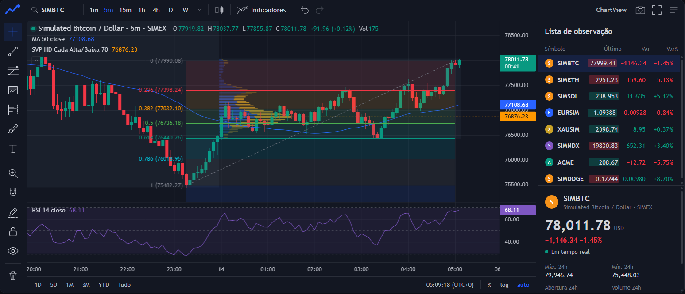
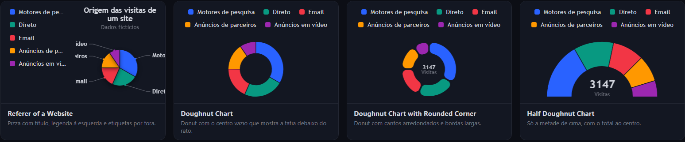
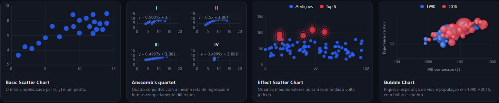
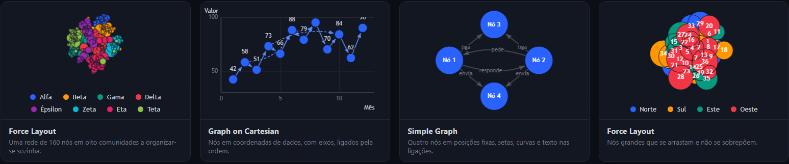
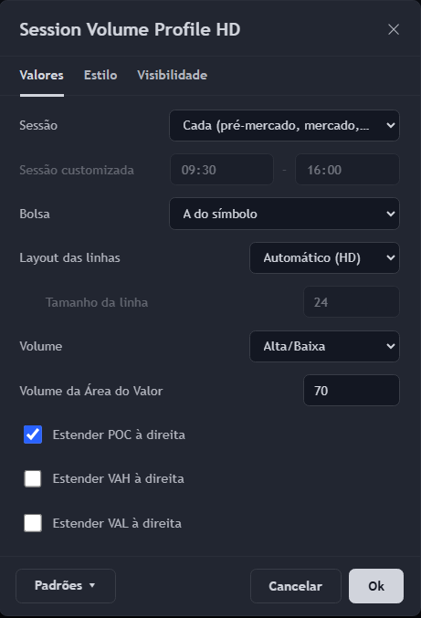
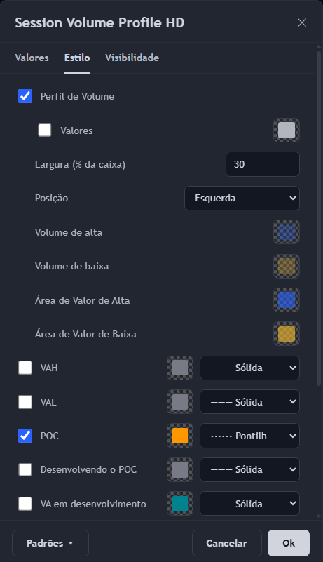
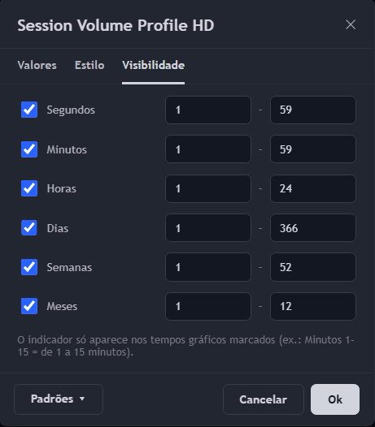

# OpenChartsCandle

**Gráficos financeiros e de dados para a web, em TypeScript e Canvas 2D, sem dependências em runtime.**

Um terminal de velas completo ao estilo TradingView (ferramentas de desenho, indicadores, trades, sessões, fusos horários) e mais 17 famílias de gráficos ao estilo ECharts: pizza, linhas, barras, velocímetros, treemap, dispersão, mapas de calor, grafos, sankey e outras.

[](https://github.com/TTiagoSousa/OpenChartsCandle/actions/workflows/ci.yml)
[](https://github.com/TTiagoSousa/OpenChartsCandle/releases)
[](LICENSE)
[](https://ttiagosousa.github.io/OpenChartsCandle/)

[Demo e galeria](https://ttiagosousa.github.io/OpenChartsCandle/) · [Documentação](#documentação) · [Changelog](CHANGELOG.md) · [English](README.md)



## Porquê

- **Sem dependências em runtime.** Cada gráfico é desenhado num canvas pela própria biblioteca. Importas só a família que usas.
- **Como o TradingView onde interessa.** Os mesmos valores nos indicadores, a mesma janela de definições (Valores / Estilo / Visibilidade), scroll com inércia, velas nítidas ao pixel, histórico carregado aos blocos.
- **Feito para aplicações de trading.** Ligas o teu datafeed, mostras os trades de um backtest com P&L ao vivo, desenhas as sessões de qualquer bolsa e mudas de fuso horário.
- **Tipado.** Escrito em TypeScript estrito, com declarações para cada entrada.

## Famílias de gráficos

Cada família tem a sua entrada de import, as suas docs e os seus exemplos. A [galeria](https://ttiagosousa.github.io/OpenChartsCandle/#/galeria) tem 279 gráficos prontos a copiar.

| Família | Import | O que desenha |
|---|---|---|
| **Candlestick** | `openchartscandle/candlestick` | Terminal ao estilo TradingView ou só o gráfico: velas, barras, Heikin Ashi, linha, área, baseline |
| **Pie** | `openchartscandle/pie` | Pizza, donut, meio donut, rosa (Nightingale) |
| **Line** | `openchartscandle/line` | Linhas e áreas, empilhadas, suaves ou em degraus, tempo real |
| **Bar** | `openchartscandle/bar` | Colunas e barras, agrupadas, empilhadas, 100%, médias móveis, tendências, Pareto |
| **Gauge** | `openchartscandle/gauge` | Velocímetros, anéis de progresso, zonas e marcadores |
| **Treemap** | `openchartscandle/treemap` | Treemap squarified e sunburst, navegação por níveis |
| **Scatter** | `openchartscandle/scatter` | Dispersão e bolhas, regressões, clusters, matriz de dispersão |
| **Calendar** | `openchartscandle/calendar` | Dias em mapa de calor (como o GitHub) ou calendário de parede |
| **Radar** | `openchartscandle/radar` | Radar / teia de indicadores |
| **Boxplot** | `openchartscandle/boxplot` | Caixas de bigodes a partir dos valores ou já calculadas |
| **Heatmap** | `openchartscandle/heatmap` | Mapas de calor, matrizes de correlação, 20 000+ células |
| **Graph** | `openchartscandle/graph` | Redes com layout de forças (Barnes–Hut), circular ou fixo |
| **Tree** | `openchartscandle/tree` | Árvores arrumadas em quatro orientações e radial |
| **Parallel** | `openchartscandle/parallel` | Coordenadas paralelas com seleção e eixos arrastáveis |
| **Sankey** | `openchartscandle/sankey` | Diagramas de fluxos |
| **Funnel** | `openchartscandle/funnel` | Funis e pirâmides com taxas de conversão |
| **Matrix** | `openchartscandle/matrix` | Grelhas com cabeçalhos em vários níveis e gráficos dentro das células |
| **Custom** | `openchartscandle/custom` | Séries próprias com `renderItem`, transições animadas, hexbin, circle packing |





## O terminal de velas

`createTerminal` monta a interface toda. `createChart` dá-te só o canvas, para montares a tua própria interface à volta.

### O que tem

| Área | Funcionalidades |
|---|---|
| **Tipos de gráfico** | Velas, barras (OHLC), velas ocas, Heikin Ashi, linha, linha em degraus, área, baseline |
| **Timeframes** | 1m, 3m, 5m, 15m, 30m, 1h, 2h, 4h, 1D, 1W ou personalizados (`'45'`, `'2h'`, `'3D'`); escreve `15` + Enter no gráfico para mudar |
| **Escala de preço** | Automática, logarítmica, percentagem e invertida; linha do último preço com o tempo que falta para a vela fechar |
| **Navegação** | Scroll com inércia, zoom com a roda, botões de intervalo (1D, 5D, 1M, 3M, YTD, Tudo), ir para uma data ou para um trade |
| **Dados** | Interface `Datafeed` com histórico aos blocos (como o TradingView), tempo real e ressincronização depois de uma ligação cair |
| **Fusos horários** | Hora do browser, UTC, o fuso da bolsa ou qualquer fuso IANA, pelo menu do relógio ou por código |
| **Interface** | Pesquisa de símbolos, watchlist com detalhes do símbolo, legenda, desfazer / refazer, captura, ecrã inteiro, atalhos de teclado |
| **Aparência** | Tema escuro e claro, todas as cores configuráveis, modo só gráfico, modo compacto para cards, bordas e cantos arredondados |
| **Trades** | Entradas e saídas de uma estratégia com P&L ao vivo, só entradas / só saídas / ambas, lista de trades ligada ao gráfico, ir para um trade pelo id, estatísticas |
| **Anotações** | Marcadores, zonas e linhas no tempo |

Cada peça da interface pode ser desligada ou limitada a uma lista:

```ts
createTerminal(el, {
  datafeed,
  watchlist: false,
  timeframeSelector: ['5', '15', '60', '240', '1D'],
  chartTypes: ['candles', 'heikin', 'line'],
  indicatorPicker: ['sma', 'rsi'],
  drawingTools: ['trendline', 'hline', 'fib', 'long', 'short', 'rect'],
  screenshot: false,
});
```

### Ferramentas de desenho

26 ferramentas, com íman (cola ao OHLC), Shift para ângulos de 45°, desfazer / refazer, copiar / colar, bloquear, ocultar, clonar e uma janela de definições por desenho. Os desenhos também se criam por código e guardam-se onde quiseres.

| Grupo | Ferramentas |
|---|---|
| **Linhas** | Linha de tendência, raio, linha de informação (Δ preço, %, barras, ângulo), linha estendida, seta, linha horizontal, raio horizontal, linha vertical, linha cruzada, canal paralelo |
| **Fibonacci** | Retração, extensão baseada em tendência, canal de Fibonacci |
| **Previsão** | Posição comprada, posição vendida, intervalo de preço, intervalo de data, intervalo de data e preço |
| **Volume** | Perfil de volume de intervalo fixo, VWAP ancorado |
| **Formas** | Pincel, retângulo, elipse, triângulo, caminho |
| **Anotação** | Texto |

### Indicadores

Os indicadores dão os mesmos valores que o TradingView e são calculados de forma incremental em tempo real. Qualquer um pode usar outro tempo gráfico que não o do gráfico (uma média de 4h num gráfico de 5m).

| Indicador | `type` | Definições |
|---|---|---|
| **Moving Average** | `sma` | Período, fonte (abertura, máxima, mínima, fecho, volume), deslocamento, tempo gráfico, cor, espessura |
| **Moving Average Exponential** | `ema` | As mesmas da SMA |
| **Relative Strength Index** | `rsi` | Período, fonte, tempo gráfico; média do RSI (SMA ou EMA); banda superior, do meio e inferior com nível e cor; fundo entre as bandas |
| **Session Volume Profile HD** | `svp` | Ver abaixo |

O **Session Volume Profile HD** corta o gráfico nas sessões do dia e desenha um perfil de volume para cada uma, como o do TradingView:

- **Sessões:** cada parte à parte (pré-mercado, mercado, pós-mercado, noturno), todas juntas, só uma parte, ou um horário próprio (`'0930-1600'`, vários intervalos, a passar a meia-noite).
- **Bolsas:** o horário do símbolo, ou NYSE / Nasdaq, CME, B3, Euronext, Xetra, LSE, TSE, HKEX, Forex e cripto, cada uma no seu fuso.
- **Linhas:** linhas HD automáticas que acompanham o zoom, um número fixo de linhas, ou ticks por linha.
- **Volume:** alta / baixa, total ou delta; percentagem da área de valor (70% por defeito).
- **Níveis:** POC, VAH e VAL, cada um com cor e estilo de linha, estendidos para a direita até uma vela lhes tocar; POC e área de valor em desenvolvimento.
- **Estilo:** largura e lado do histograma, cores de alta / baixa e da área de valor, uma caixa de fundo por sessão, valores nas linhas, etiquetas na escala de preço.

### Janela de definições

Cada indicador abre a mesma janela que no TradingView, com os separadores **Valores**, **Estilo** e **Visibilidade**, o menu "Padrões" para repor as predefinições e "Cancelar" para desfazer tudo. A Visibilidade escolhe em que tempos gráficos o indicador aparece (segundos, minutos, horas, dias, semanas e meses, cada um com um intervalo).

| Valores | Estilo | Visibilidade |
|---|---|---|
|  |  |  |

### Atalhos de teclado

| Tecla | Ação |
|---|---|
| `Alt + T` / `H` / `J` / `V` / `C` / `F` | Linha de tendência, horizontal, raio horizontal, vertical, cruzada, Fibonacci |
| `Del` / `Backspace` | Apagar o desenho selecionado |
| `Esc` | Cancelar o desenho atual, sair da ferramenta, desselecionar |
| `Ctrl + Z` / `Ctrl + Y` | Desfazer / refazer |
| `Ctrl + C` / `Ctrl + V` | Copiar / colar o desenho selecionado |
| `Alt + R` | Repor a vista do gráfico |
| `←` `→` / `↑` `↓` | Scroll / zoom |
| `15` + `Enter`, `4h`, `D`, `W` | Mudar de timeframe a escrever |

## Instalação

Instala uma versão (tag) diretamente do GitHub. O build (`dist/`) vem em cada versão, por isso não se compila nada ao instalar.

```bash
npm install github:TTiagoSousa/OpenChartsCandle#v1.0.0
```

Para atualizar, muda a tag e corre `npm install` outra vez. Vê [docs/versoes.md](docs/versoes.md).

## Uso rápido (candlestick)

### Terminal completo

```ts
import { createTerminal, type Datafeed } from 'openchartscandle/candlestick';
import 'openchartscandle/style.css';

const datafeed: Datafeed = {
  getSymbols: () => [{ symbol: 'BTCUSDT', precision: 2 }],
  // histórico aos blocos: `to` exclusivo, `countBack` velas, `signal` para cancelar
  getBars: async (symbol, tf, { to, countBack, signal }) => {
    const bars = await api.candles(symbol, tf.id, to, countBack, signal);
    return { bars, noMore: bars.length < countBack };
  },
  // tempo real: chama onBar com cada vela nova ou atualizada e devolve a função para cancelar
  subscribeBars: (symbol, tf, onBar) => socket.subscribe(symbol, tf.id, onBar),
};

createTerminal(document.getElementById('grafico')!, { datafeed, symbol: 'BTCUSDT', timeframe: '5' });
```

O contentor tem de ter altura definida, por exemplo `#grafico { height: 600px }`. Vê [docs/candlestick/datafeed.md](docs/candlestick/datafeed.md).

### Só o gráfico

```ts
import { createChart, createIndicator } from 'openchartscandle/candlestick';
import 'openchartscandle/style.css';

const chart = createChart(document.getElementById('grafico')!, { symbol: { symbol: 'EURUSD', precision: 5 } });

chart.setData(velas, 3600);  // histórico; 3600 = velas de 1 hora
chart.update(velaAtual);     // tempo real: a mesma hora substitui, uma hora nova acrescenta
chart.addIndicator(createIndicator('rsi', { maType: 'ema', maLength: 9 })!);
chart.addIndicator(createIndicator('svp', { session: 'regular', exchange: 'NYSE' })!);
chart.setTimezone('Europe/Lisbon');
chart.drawings.setTool('fib');
```

Uma vela é `{ time, open, high, low, close, volume }`, com `time` no **início** da vela em segundos UTC (milissegundos também são aceites). As velas são ordenadas e os duplicados removidos, e os buracos (fins de semana, mercado fechado) não deixam espaços vazios.

## Exemplos por família

### Pie · pizza, donut e rosa

```ts
import { createPieChart } from 'openchartscandle/pie';
import 'openchartscandle/style.css';

const chart = createPieChart(document.getElementById('pizza')!, {
  data: [{ label: 'Ações', value: 60 }, { label: 'Obrigações', value: 25 }, { label: 'Liquidez', value: 15 }],
  innerRadius: 0.6, // donut
});
chart.setData(novosDados); // anima para os novos valores
```

Inclui tooltip (com formatador próprio), legenda interativa (esconder e mostrar fatias), etiquetas dentro ou fora com linhas-guia, texto no centro do donut, hover e seleção, agrupamento em "Outros", meio donut (gauge), rosa (Nightingale), espaço entre fatias, cantos arredondados, temas, eventos, animações e PNG. Vê [docs/pie/api.md](docs/pie/api.md) e a **galeria** do site (`#/galeria/pie`).

### Line · linhas e áreas

```ts
import { createLineChart } from 'openchartscandle/line';

const chart = createLineChart(document.getElementById('linhas')!, {
  series: [
    { name: 'Receita', data: [42, 48, 51, 49, 58, 63] },
    { name: 'Custos', data: [30, 33, 35, 36, 38, 41], dash: [6, 4] },
  ],
  categories: ['Jan', 'Fev', 'Mar', 'Abr', 'Mai', 'Jun'],
  curve: 'smooth',
});
chart.appendPoint('Receita', 70); // tempo real
```

Inclui várias séries, eixo de tempo, números ou categorias, dois eixos Y, áreas (gradiente) e áreas empilhadas (normal ou 100%), curvas reta, suave ou em degraus, pontos, falhas nos dados, tooltip partilhado ou individual, crosshair, legenda interativa, anotações (linhas, faixas, eventos), zoom e pan, tempo real com janela deslizante, temas e fundo transparente. Vê [docs/line/api.md](docs/line/api.md) e a **galeria de exemplos** do site (`#/galeria/line`).

### Bar · barras e colunas

```ts
import { createBarChart } from 'openchartscandle/bar';

createBarChart(document.getElementById('barras')!, {
  categories: ['T1', 'T2', 'T3', 'T4'],
  series: [
    { name: '2024', data: [118, 131, 139, 162] },
    { name: '2025', data: [131, 149, 158, 181] },
  ],
  stacked: false, // true ou 'percent'
});
```

Inclui séries agrupadas, empilhadas, em 100% e grupos de pilhas, valores negativos (com `colorBy` ou `negativeColor`), vertical ou horizontal, ordenação, valores nas barras, tooltip partilhado ou por barra com total, legenda interativa, linhas de referência, médias móveis (simples, exponencial, ponderada), tendência linear e exponencial, acumulado e Pareto com segundo eixo, animações, temas e fundo transparente. Vê [docs/bar/api.md](docs/bar/api.md) e a **galeria** do site (`#/galeria/bar`).

### Gauge · velocímetros e medidores

```ts
import { createGauge, trafficZones } from 'openchartscandle/gauge';

const gauge = createGauge(document.getElementById('velocimetro')!, {
  value: 90,
  max: 240,
  unit: 'km/h',
  zones: trafficZones(0, 240),
});
gauge.setValue(130); // o ponteiro anima com efeito de mola
```

Inclui velocímetro (240°), meio círculo, anel completo ou ângulos próprios, ponteiro clássico, linha ou seta, arco de progresso, zonas com nome ou gradiente, marcas grandes e pequenas, marcadores, valor com unidade na cor da zona, tooltip, evento `zone`, temas e fundo transparente. Vê [docs/gauge/api.md](docs/gauge/api.md) e a **galeria** do site (`#/galeria/gauge`).

### Treemap · treemap e sunburst

```ts
import { createTreemap } from 'openchartscandle/treemap';

const chart = createTreemap(document.getElementById('mapa')!, {
  data: [
    { name: 'Tecnologia', children: [{ name: 'AAPL', value: 3400 }, { name: 'MSFT', value: 3100 }] },
    { name: 'Energia', children: [{ name: 'XOM', value: 480 }, { name: 'CVX', value: 290 }] },
  ],
  upperLabel: true,
});

chart.setType('sunburst'); // cada retângulo transforma-se no seu setor
```

Inclui treemap squarified e sunburst, cores por nível (paleta, saturação, luminosidade ou gradiente pelo valor de outra dimensão), cabeçalhos dos pais, etiquetas com formato próprio, clique para entrar com caminho de volta, `leafDepth`, tooltip com caminho e percentagens, eventos, temas e transições animadas (zoom, dados e treemap ↔ sunburst). Vê [docs/treemap/api.md](docs/treemap/api.md) e a **galeria** do site (`#/galeria/treemap`).

### Scatter · dispersão e bolhas

```ts
import { createScatterChart } from 'openchartscandle/scatter';

const chart = createScatterChart(document.getElementById('dispersao')!, {
  series: [{ name: 'Países', data: [[1516, 68, 1311], [53354, 79, 321], [27000, 81, 10.4]], regression: 'logarithmic' }],
  xAxis: { type: 'log', title: 'PIB por pessoa' },
  visualMap: { dimension: 2, sizes: [8, 40], title: 'População' },
});
```

Inclui eixos de valor, log, categorias (com jitter) ou polares, nove símbolos que mudam de forma uns nos outros, cor e tamanho por valor (`visualMap` contínuo ou por peças, com filtro), regressões linear, exponencial, logarítmica e polinomial com fórmula e R², k-means e contornos, marcas (máximo, mínimo, média, intervalo), ondas (`effect`), etiquetas alinhadas sem sobreposição, centenas de milhares de pontos (`large`, `appendData`, `blend`), zoom, seleção com `brush`, matriz de dispersão ligada (`createScatterMatrix`) e transições animadas (até de pontos para barras). Vê [docs/scatter/api.md](docs/scatter/api.md) e a **galeria** do site (`#/galeria/scatter`).

### Calendar · dias em mapa de calor

```ts
import { createCalendarChart } from 'openchartscandle/calendar';

const chart = createCalendarChart(document.getElementById('calendario')!, {
  range: 2026,                                   // ou '2026-10' (um mês), [2024, 2025, 2026]
  data: [['2026-01-05', 12], ['2026-01-06', 30]],
  visualMap: { min: 0, max: 40, title: 'Commits' },
});
```

Inclui anos com uma coluna por semana (como o GitHub) ou meses como um calendário de parede (`orient: 'vertical'`), vários anos, mapa de calor contínuo ou por intervalos com legenda que filtra, círculos do tamanho do valor com ondas nos maiores, contorno dos meses, etiquetas em várias linhas, desenho próprio por dia (`renderCell`) e por cima (`graphic`), tooltip, eventos e temas. Vê [docs/calendar/api.md](docs/calendar/api.md) e a **galeria** do site (`#/galeria/calendar`).

### Radar · teia de indicadores

```ts
import { createRadarChart } from 'openchartscandle/radar';

const chart = createRadarChart(document.getElementById('radar')!, {
  indicators: [{ name: 'Retorno', max: 10 }, { name: 'Risco', max: 10 }, { name: 'Liquidez', max: 10 }],
  series: [
    { name: 'Fundo A', data: [8, 4, 9], area: true },
    { name: 'Fundo B', data: [5, 8, 6], area: true },
  ],
});
```

Inclui um eixo por indicador com o seu mínimo e máximo, anéis em polígono ou círculo, faixas, um ou muitos polígonos por série (um por dia, por ano), áreas sólidas ou em gradiente, linhas tracejadas, símbolos e valores nos vértices, vários radares no mesmo gráfico, cor por ano (`visualMap`), legenda clicável, tooltip, eventos, temas e animações (`setSeries` muda a forma). Vê [docs/radar/api.md](docs/radar/api.md) e a **galeria** do site (`#/galeria/radar`).

### Boxplot · caixas de bigodes

```ts
import { createBoxplotChart } from 'openchartscandle/boxplot';

createBoxplotChart(el, {
  categories: ['Exp. 1', 'Exp. 2', 'Exp. 3'],
  series: [{ name: 'Medições', samples: [[850, 740, 900, 1070], [960, 940, 880], [880, 720, 620, 860]] }],
  mean: true,
});
```

Inclui caixas dadas prontas (`[mínimo, Q1, mediana, Q3, máximo]`) ou calculadas a partir dos valores (quartis por interpolação linear, bigodes a 1,5 × IQR, outliers), `boxplotStats` e `boxplotAggregate` para usares à parte, várias séries lado a lado em cada categoria, orientação vertical ou horizontal, marcador da média, pontos dispersos por cima ou ao lado da caixa, eixo de valores com marcas redondas, legenda clicável, tooltip com os cinco números, temas escuro/claro/próprio, fundo transparente e animações. Vê [docs/boxplot/api.md](docs/boxplot/api.md) e a **galeria** do site (`#/galeria/boxplot`).

### Heatmap · mapas de calor

```ts
import { createHeatmapChart, heatmapCorrelation } from 'openchartscandle/heatmap';

const ativos = ['BTC', 'ETH', 'AAPL', 'Ouro'];
const chart = createHeatmapChart(document.getElementById('heatmap')!, {
  xAxis: { data: ativos },
  yAxis: { data: ativos, inverse: true },
  matrix: heatmapCorrelation(retornos), // um array de retornos por ativo
  label: { format: (v) => v.toFixed(2) },
  visualMap: { min: -1, max: 1, colors: ['#f23645', '#f7f7f7', '#089981'] },
});
```

Inclui categorias ou intervalos numéricos em x e y, dados em `[x, y, valor]`, objetos ou matriz, cores em gradiente com pegas que filtram ou por intervalos que se escondem com um clique, etiquetas com a cor do texto escolhida para se ler (só onde cabem), etiquetas dos eixos que rodam ou se espaçam quando não cabem, células quadradas, espaço e cantos redondos, destaque da linha e da coluna, zoom e arrastar, tooltip, eventos, temas, animação de entrada e 20 000 células ou mais desenhadas em poucos milissegundos. Traz também `heatmapCorrelation` e `heatmapReturns` para matrizes de correlação de ativos. Vê [docs/heatmap/api.md](docs/heatmap/api.md) e a **galeria** do site (`#/galeria/heatmap`).

### Graph · grafos e redes

```ts
import { createGraphChart } from 'openchartscandle/graph';

const chart = createGraphChart(el, {
  nodes: [
    { id: 'a', name: 'Ana', category: 0, value: 12 },
    { id: 'b', name: 'Rui', category: 1, value: 5 },
  ],
  links: [{ source: 'a', target: 'b' }],
  categories: ['Equipa A', 'Equipa B'],
  symbolSize: [10, 30],
  label: { show: true },
});
```

Inclui layout de forças (repulsão Barnes–Hut, molas, gravidade e arrefecimento animado, rápido com milhares de nós), layout circular com nomes rodados e posições fixas, categorias com legenda que as esconde, tamanho pelo valor, etiquetas que se escondem quando se tapam, arestas retas ou curvas com setas e texto, destaque dos vizinhos ao passar o rato, tooltip, arrastar nós, zoom e pan, eixos numéricos (lineares ou logarítmicos), desenho próprio por baixo e por cima (`underlay` / `graphic`, para mapas e calendários), `setData` animado, temas e `graphForceLayout()` para calcular grafos grandes uma só vez. Vê [docs/graph/api.md](docs/graph/api.md) e a **galeria** do site (`#/galeria/graph`).

### Tree · hierarquias

```ts
import { createTreeChart } from 'openchartscandle/tree';

const chart = createTreeChart(el, {
  data: {
    name: 'Mercados',
    children: [
      { name: 'Ações', children: [{ name: 'Apple', value: 3400 }, { name: 'Nvidia', value: 3300 }] },
      { name: 'Cripto', children: [{ name: 'Bitcoin' }, { name: 'Ethereum' }] },
    ],
  },
  orient: 'LR', // 'RL', 'TB', 'BT' ou layout: 'radial'
  initialDepth: 1,
});
```

Inclui árvore arrumada (Reingold–Tilford: pais ao centro dos filhos, subárvores juntas sem se cruzarem), quatro orientações e layout radial, ligações curvas ou em cotovelo, seis símbolos, nós que abrem e fecham com um click (animado, com `initialDepth`, `expandAll` e `collapseAll`), etiquetas que rodam nas árvores verticais, seguem o raio na radial e se escondem quando se tapam, margens calculadas para os nomes, várias árvores no mesmo gráfico com legenda, destaque do caminho até à raiz, tooltip com o caminho, zoom e pan, `setData` animado e temas. Vê [docs/tree/api.md](docs/tree/api.md) e a **galeria** do site (`#/galeria/tree`).

### Parallel · coordenadas paralelas

```ts
import { createParallelChart } from 'openchartscandle/parallel';

createParallelChart(el, {
  axes: [{ name: 'Retorno %' }, { name: 'Volatilidade %' }, { name: 'Sharpe' }],
  series: [{ name: 'Fundos', data: [[8.2, 14, 0.6], [5.1, 6, 0.9], [12.4, 22, 0.5]] }],
});
```

Inclui eixos de valores (lineares ou log, com mínimo e máximo arredondados, invertidos) e de categorias, layout horizontal ou vertical, linhas retas ou curvas, cores por série ou por uma dimensão (visualMap contínuo ou por intervalos), seleção por arrasto em cada eixo (vários eixos combinam-se) com o evento `brush`, eixos que se reordenam arrastando o nome, milhares de linhas, legenda, tooltip e temas. Vê [docs/parallel/api.md](docs/parallel/api.md) e a **galeria** do site (`#/galeria/parallel`).

### Sankey · fluxos

```ts
import { createSankeyChart } from 'openchartscandle/sankey';

createSankeyChart(el, {
  nodes: [{ name: 'Salário' }, { name: 'Orçamento' }, { name: 'Casa' }, { name: 'Poupança' }],
  links: [
    { source: 'Salário', target: 'Orçamento', value: 2400 },
    { source: 'Orçamento', target: 'Casa', value: 900 },
    { source: 'Orçamento', target: 'Poupança', value: 600 },
  ],
});
```

Inclui nós em colunas com altura pelo valor e um layout que desembaraça as ligações, alinhamento `justify`, `left` ou `right`, orientação horizontal ou vertical, cores por nó ou por nível, ligações com a cor da origem, do destino, em gradiente ou fixa, destaque das adjacências, tooltip com totais, nós arrastáveis, animações e temas. Os ciclos são ignorados e ficam em `getIgnoredLinks()`. Vê [docs/sankey/api.md](docs/sankey/api.md) e a **galeria** do site (`#/galeria/sankey`).

### Funnel · funis e pirâmides

```ts
import { createFunnelChart } from 'openchartscandle/funnel';

createFunnelChart(el, {
  data: [
    { name: 'Visitas', value: 48000 },
    { name: 'Registos', value: 12600 },
    { name: 'Primeiro depósito', value: 3900 },
    { name: 'Primeira ordem', value: 2600 },
  ],
  gap: 3,
});
```

Inclui funil, pirâmide (`sort: 'ascending'`) ou a ordem dada, vertical ou horizontal, `minSize`/`maxSize`, espaço entre etapas, alinhamento à esquerda, à direita ou ao centro, etiquetas por fora com linhas (com espaço reservado) ou por dentro (só onde cabem), vários funis lado a lado ou um por cima do outro (meta e real), legenda que esconde etapas em todos os funis, tooltip com a conversão desde a primeira etapa e desde a anterior, animações e temas. Vê [docs/funnel/api.md](docs/funnel/api.md) e a **galeria** do site (`#/galeria/funnel`).

### Matrix · matrizes e grelhas

```ts
import { createMatrixChart } from 'openchartscandle/matrix';

const chart = createMatrixChart(el, {
  x: { data: [{ value: '2025', children: ['T1', 'T2'] }, { value: '2026', children: ['T1', 'T2'] }] },
  y: { data: ['Norte', 'Centro', 'Sul'] },
  data: [
    [120, 134, 141, 158],
    [88, 91, 97, 104],
    [210, 225, 248, 262],
  ],
  visualMap: { min: 80, max: 270 },
});
```

Inclui cabeçalhos em vários níveis nos dois lados, células unidas e buracos, tamanhos em px, `fr` ou `%`, cores por visualMap (contínuo, intervalos ou categorias) com legenda que filtra, texto, desenho próprio rápido em canvas (`renderCell`), **gráficos de qualquer família dentro das células** (`mount`), uma camada `graphic` por cima com o retângulo de cada célula, realce em cruz, seleção, tooltip e regras `media` para dashboards que se reorganizam com a largura. Vê [docs/matrix/api.md](docs/matrix/api.md) e a **galeria** do site (`#/galeria/matrix`).

### Custom · séries próprias

```ts
import { createCustomChart } from 'openchartscandle/custom';

const chart = createCustomChart(el, {
  xAxis: { type: 'category' },
  series: [
    {
      name: 'Resultado',
      data: [['Jan', 42], ['Fev', -18], ['Mar', 65]],
      renderItem: (params, api) => {
        const [x, y] = api.coord([api.value(0), api.value(1)]);
        const [, y0] = api.coord([api.value(0), 0]);
        const w = api.size([1, 0])[0] * 0.6;
        return { type: 'rect', shape: { x: x - w / 2, y: Math.min(y, y0), width: w, height: Math.abs(y0 - y) }, style: api.style() };
      },
    },
  ],
});
```

Inclui coordenadas cartesianas (valor, categoria, tempo, log), polares ou em píxeis; retângulos, círculos, setores, polígonos, caminhos SVG, texto, imagens e grupos; tooltip, destaque, click, arrastar formas, zoom e pan; **transições animadas** entre formas com o mesmo `id` (um ponto pode virar um setor), modo `live` para efeitos contínuos, e os ajudantes `customHistogram`, `customHexbin` e `customPack` (circle packing sem d3). Vê [docs/custom/api.md](docs/custom/api.md) e a **galeria** do site (`#/galeria/custom`).

## Documentação

A referência completa está em [`docs/`](docs) e no [site de demonstração](https://ttiagosousa.github.io/OpenChartsCandle/), onde cada exemplo corre ao vivo ao lado do seu código.

| Tema | Documento |
|---|---|
| API do candlestick (`createTerminal`, `createChart`, `Chart`, eventos, tema, indicadores) | [docs/candlestick/api.md](docs/candlestick/api.md) |
| Ligar dados (`Datafeed`, exemplos da Binance e de base de dados própria) | [docs/candlestick/datafeed.md](docs/candlestick/datafeed.md) |
| Aparência (temas, só o gráfico, compacto, fusos horários) | [docs/candlestick/aparencia.md](docs/candlestick/aparencia.md) |
| Ferramentas de desenho (ids, atalhos, desenhos por código, guardar) | [docs/candlestick/desenhos.md](docs/candlestick/desenhos.md) |
| Entradas e saídas, marcadores, estatísticas e indicadores da simulação | [docs/candlestick/entradas-saidas.md](docs/candlestick/entradas-saidas.md) |
| Outras famílias | `docs/<família>/api.md`, por exemplo [docs/heatmap/api.md](docs/heatmap/api.md) |
| Estrutura do projeto e como acrescentar uma família | [docs/estrutura.md](docs/estrutura.md) |
| Versões e publicação | [docs/versoes.md](docs/versoes.md) |

## Desenvolvimento

```bash
npm install
npm run dev        # site de exemplos em http://localhost:5190
npm test           # testes (Vitest)
npm run typecheck  # verificação de tipos
npm run build      # dist/: uma entrada por família, tipos e CSS
npm run check      # tudo isto, como no CI
```

Vê o [CONTRIBUTING.md](CONTRIBUTING.md) para o fluxo de ramos, o estilo dos commits e as releases.

## Licença

O OpenChartsCandle é software livre, com a licença [GNU General Public License v3.0](LICENSE).

Partes do motor candlestick (scroll com inércia, zoom e largura das velas) foram adaptadas do [TradingView Lightweight Charts™](https://github.com/tradingview/lightweight-charts), licenciado em Apache 2.0; vê o [NOTICE](NOTICE). "TradingView" é uma marca da TradingView, Inc. Este projeto não é afiliado nem apoiado pela TradingView, Inc.
